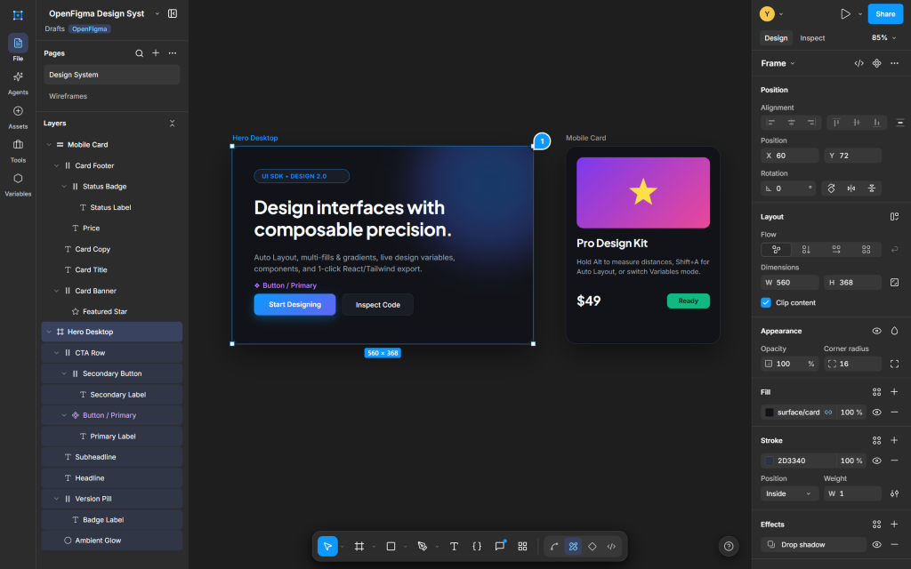
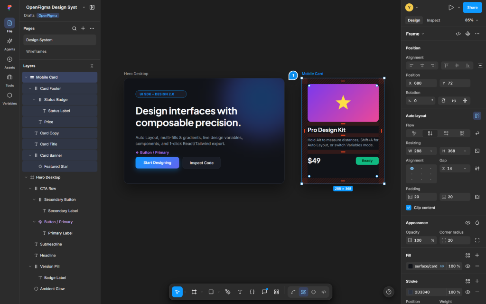

<div align="center">

# OpenFigma

**The open-source Figma UI3 starter template for building collaborative design tools, vector editors, and canvas applications.**

[](https://openfigma.vercel.app/)
[](./LICENSE)
[](https://react.dev)
[](https://www.typescriptlang.org)
[](https://tailwindcss.com)
[](https://www.npmjs.com/package/@ui-sdk/react)
[](https://github.com/ehtisham-afzal/openfigma/generate)

**[🚀 Live Preview](https://openfigma.vercel.app/)** · **[✨ Use This Template](https://github.com/ehtisham-afzal/openfigma/generate)** · **[📖 Quick Start](#quick-start)**

<br />

<a href="https://openfigma.vercel.app/">
  
</a>

</div>

---

## Why OpenFigma?

Building a Figma-class design tool, diagramming canvas, slide editor, or creative studio from scratch takes months of pixel-level UI engineering before you even start on your unique product features.

**OpenFigma** gives you a **production-clean, MIT-licensed Figma UI3 foundation** out of the box:

- **Pixel-faithful Figma UI3 shell & design system** (`#2c2c2c` panels, `#383838` inputs, `#444444` hairlines, `57px` left rail, `240px` left sidebar, `252px` right inspector, `48px` centered floating bottom toolbar, native `24×24px` FPL vector icons, and dark custom scrollbars).
- **Reusable Figma UI3 Core Component Library** in [`src/components/ui/`](./src/components/ui/) — scrubbable `NumberField` with live math expression evaluation (`560/2 → 280`), `ColorField`, `FillField`, `EffectPopoverField`, `SegmentedField`, `IconButton`, `InspectorSection`, and more.
- **Designer-grade interactive canvas** — infinite pan/zoom, Auto Layout engine with on-canvas pink padding/gap scrubbing, Cubic Bézier Pen & smooth Pencil tools, draggable ruler guides, smart snap alignment, `Alt+Hover` redline distance measurement, live Eyedropper loupe (`I`), parent-attached draggable comments, inline label renaming, and undo/redo history.
- **Dev Mode, Design Variables, Components & Prototype Presentation** — complete with `SVG`, `PNG 2×`, `.json`, and React + Tailwind JSX export.
- **Agent-Ready UI** powered by `@ui-sdk/react` — every control is accessible, semantically labeled, and inspectable/operable via `createAgent().snapshot()`.

---

## Feature Showcase

### On-Canvas Auto Layout Scrubbing & Live Inspector
Select any Auto Layout frame to scrub padding (`Alt` for symmetric opposite sides, `Shift` for `8px` steps) and child gaps right on the canvas, or double-click any pink handle to type an exact value inline.



### Complete Capabilities

| Area | Included Features |
| :--- | :--- |
| **Infinite Canvas** | Cursor-centered `Ctrl+Scroll` zoom (prevents browser page zoom), `Space+Drag` / middle-click pan, marquee selection, multi-selection outlines, smart object & guide snapping, `Alt+Hover` redlines, drag-out-of-frame auto-unparenting, image drag-and-drop |
| **Vector & Shape Tools** | **Cubic Bézier Pen (`P`)** with symmetric curve handles & live preview, **Smooth Freehand Pencil (`Shift+P`)**, Frame (`F`), Section, Rectangle (`R`), Ellipse (`O`), Line (`L`), Polygon, Star (`Shift+S`), Auto-growing Text (`T`), Live **Eyedropper Loupe (`I`)** |
| **Auto Layout** | Horizontal & Vertical stacks, `Fixed` / `Hug` / `Fill` sizing, 3×3 alignment matrix (double-click for `Space between`), `Ignore auto layout` (`layoutAbsolute`), interactive on-canvas pink padding & gap handles |
| **Left Navigation & Layers** | 5-tab `57px` rail (`File`, `Agents`, `Assets`, `Tools`, `Variables`), multi-page manager with inline rename & context menus, `Ctrl+F` layer search with type filter pills, `Shift+Click` range select, double-click icon to zoom, `Alt+L` collapse/expand all, directional drag-and-drop reparenting, right-click layer menu |
| **Right Properties Panel** | Alignment, Position/Rotation/Flip, Auto Layout, Appearance (Opacity, Blend Mode, Uniform & Independent Corner Radius, Clip Content), Typography, Multi-Fills (Solid, Linear, Radial, Image) & Variable Binding, Strokes (Inside/Center/Outside, Solid/Dashed), Effects (Drop Shadow, Inner Shadow, Layer Blur, Background Blur), Selection Colors batch editor, Export with live SVG preview |
| **Collaboration & Modes** | **Parent-attached draggable Comment pins (`C`)** with inline composer & reply threads, **Dev Mode (`Shift+D`)** with CSS Box Model / JSX / Tokens inspector, **Prototype Presentation Modal** with slide switcher & responsive Fit/100% scaling, **Quick Actions (`Ctrl+K`)**, **Searchable Shortcuts (`?`)**, **UI3 Focus Mode (`Ctrl+\`)** |
| **Import / Export** | Save & open local `.openfigma.json` files, export Vector `.svg`, Retina `2× .png`, and clean React + Tailwind `.tsx` snippets |

---

## Quick Start

### Option 1 — Use as a GitHub Template (Recommended)

Click **[Use this template](https://github.com/ehtisham-afzal/openfigma/generate)** at the top of this repository to create your own repo with a clean git history.

### Option 2 — Clone Locally

```bash
git clone https://github.com/ehtisham-afzal/openfigma.git
cd openfigma
pnpm install
pnpm dev
```

Open `http://localhost:5173` in your browser.

### Available Scripts

```bash
pnpm dev        # Start Vite dev server with HMR
pnpm test       # Run the Vitest + Testing Library + UI SDK Agent test suite
pnpm build      # TypeScript project check (tsc -b) + Vite production bundle
pnpm preview    # Preview the production build locally
```

---

## Project Architecture

```text
src/
├── components/
│   ├── ui/                      # Reusable Figma UI3 core component kit
│   │   ├── tokens.ts            # Shared control heights, surfaces & radius tokens
│   │   ├── FigmaIcons.tsx       # Native 24×24 official Figma UI3 SVG icons
│   │   ├── NumberField.tsx      # Scrubbable numeric input + safe math evaluator (560/2)
│   │   ├── TextField.tsx        # 24px FPL text input (default / ghost / inline / clearable)
│   │   ├── SelectField.tsx      # Figma-styled dropdown select
│   │   ├── SegmentedField.tsx   # 24px inset segmented control
│   │   ├── ColorField.tsx       # Swatch + hex input + HSV/alpha popover color picker
│   │   ├── FillField.tsx        # Multi-type fill row (Solid, Linear, Radial, Image, Variable)
│   │   ├── EffectPopoverField.tsx # Shadow & blur popover editor
│   │   ├── IconButton.tsx       # IconButton, IconToggle, IconMenuTrigger, SegmentedIconGroup
│   │   ├── InspectorSection.tsx # Section dividers, headers, rows & field labels
│   │   ├── CheckboxField.tsx    # 16×16 Figma checkbox
│   │   ├── ActionButton.tsx     # Compact panel action button
│   │   └── index.ts             # Barrel exports
│   ├── Canvas.tsx               # Infinite canvas, selection, snapping, Pen/Pencil, Auto Layout overlays, rulers, comments, eyedropper
│   ├── LeftSidebar.tsx          # 57px rail + 240px File/Pages/Layers/Agents/Assets/Tools/Variables panels
│   ├── RightInspector.tsx       # 252px Design & Dev Mode Inspect properties panel
│   ├── BottomToolbar.tsx        # 48px centered floating tool dock + 4-mode switcher + ? Help menu
│   ├── QuickActionsDialog.tsx   # Ctrl+K command palette, categorized Shortcuts modal & Agent Snapshot viewer
│   ├── PresentationModal.tsx    # Full-screen prototype presentation player
│   └── OpenFigmaLogo.tsx        # Brand mark
├── store/
│   ├── useDesignStore.tsx       # Document state, undo/redo history, nodes, pages, variables, comments & guides
│   └── starter.ts               # Starter showcase document & variable modes (Dark / Ocean / Light)
├── types/
│   └── design.ts                # Core TypeScript schema (DesignNode, AutoLayoutConfig, BezierPoint, CanvasComment, etc.)
├── utils/
│   ├── geometry.ts              # Bounds, hit math, object/guide snapping, redlines & Bézier/spline path builder
│   ├── layoutEngine.ts          # Recursive Auto Layout measurement & positioning engine
│   ├── paint.ts                 # Variable-aware fill/stroke/effect CSS resolver
│   └── export.ts                # Vector SVG, Retina PNG 2× & React + Tailwind JSX generators
├── index.css                    # Figma FPL dark theme CSS variables, UI SDK slot styling & custom dark scrollbars
├── App.tsx                      # Workspace shell, resizable panels, global shortcuts & action dispatcher
└── App.test.tsx                 # 16 end-to-end UI, Canvas, Inspector & Agent integration tests
```

---

## Using the Figma UI3 Component Library in Your Own App

If you only want the **Figma UI3 dark-mode inspector components** for a 3D editor, video editor, shader graph, or low-code builder, copy `src/components/ui/` and the FPL CSS tokens from `src/index.css`:

```tsx
import {
  InspectorSection,
  InspectorSectionHeader,
  NumberField,
  ColorField,
  SegmentedField,
  IconButton,
  FigmaPlusIcon,
} from "./components/ui"

export function CustomInspector() {
  return (
    <InspectorSection>
      <InspectorSectionHeader
        title="Transform"
        actions={
          <IconButton label="Add property" onClick={() => {}}>
            <FigmaPlusIcon />
          </IconButton>
        }
      />
      <div className="grid grid-cols-2 gap-1.5">
        <NumberField label="Width" prefix="W" value={560} onValueChange={console.log} />
        <NumberField label="Height" prefix="H" value={368} onValueChange={console.log} />
      </div>
      <ColorField label="Fill color" value="#0d99ff" onValueChange={console.log} />
      <SegmentedField
        label="Theme"
        value="dark"
        options={[
          { value: "dark", label: "Dark" },
          { value: "light", label: "Light" },
        ]}
        onValueChange={console.log}
      />
    </InspectorSection>
  )
}
```

### Customizing Theme Tokens

All surfaces, borders, selection colors, and control heights are driven by CSS variables in [`src/index.css`](./src/index.css):

```css
:root {
  --color-bg: #2c2c2c;
  --color-bg-canvas: #1e1e1e;
  --color-bg-secondary: #383838;
  --color-border: #444444;
  --color-bg-brand: #0d99ff;
  --color-bg-selected: #394360;
  --color-bg-dev: #14ae5c;
  --fpl-control-height: 24px;
  --fpl-row-height: 32px;
}
```

### Extending the Canvas

- **Add a new node type**: Extend `NodeType` in [`src/types/design.ts`](./src/types/design.ts), render it inside `renderNode` in [`src/components/Canvas.tsx`](./src/components/Canvas.tsx), and add its SVG export branch in [`src/utils/export.ts`](./src/utils/export.ts).
- **Add a new toolbar tool**: Add the tool to `ToolType`, wire its button/menu entry in [`src/components/BottomToolbar.tsx`](./src/components/BottomToolbar.tsx), bind its shortcut in [`src/App.tsx`](./src/App.tsx), and handle pointer events in [`src/components/Canvas.tsx`](./src/components/Canvas.tsx).
- **Connect multiplayer / CRDT sync**: Replace the localStorage persistence inside [`src/store/useDesignStore.tsx`](./src/store/useDesignStore.tsx) with Yjs, Liveblocks, PartyKit, or Cloudflare Durable Objects.

---

## Keyboard Shortcuts

| Shortcut | Action |
| :--- | :--- |
| `V` / `H` | Move tool / Hand tool |
| `F` / `R` / `O` / `L` | Frame, Rectangle, Ellipse, Line |
| `P` / `Shift + P` | Pen (Cubic Bézier) / Pencil (Smooth Freehand) |
| `T` / `C` / `I` | Text, Comment, Eyedropper color picker |
| `Shift + A` | Add or toggle Auto Layout |
| `Ctrl + G` / `Ctrl + Shift + G` | Frame selection / Ungroup |
| `Ctrl + Alt + K` | Create reusable Component |
| `Alt + Drag` | Duplicate layer on canvas (or scrub opposite Auto Layout paddings / single corner radius) |
| `Alt + Hover` | Measure redline distances to hovered layer or parent |
| `Shift + R` | Toggle interactive rulers & draggable guides |
| `Ctrl + F` / `Alt + L` | Find & filter layers / Collapse or expand all layers |
| `F2` | Rename selected layer (or double-click frame label directly on canvas) |
| `Shift + D` | Toggle Dev Mode (`Inspect`) |
| `Ctrl + K` / `?` | Quick Actions palette / Keyboard Shortcuts modal |
| `Ctrl + \` | Hide / Show UI panels (Focus Mode) |
| `Shift + 1` / `Shift + 2` / `Shift + 0` | Zoom to Fit / Selection / 100% |

---

## Tech Stack

- **[React 19](https://react.dev)** + **[TypeScript 5.8](https://www.typescriptlang.org)**
- **[Vite 6](https://vite.dev)** + **[Tailwind CSS v4](https://tailwindcss.com)**
- **[@ui-sdk/react](https://www.npmjs.com/package/@ui-sdk/react)** — accessible headless UI primitives & Agent Snapshot bridge
- **[Lucide React](https://lucide.dev)** + custom native `24×24px` Figma UI3 SVGs
- **[Vitest](https://vitest.dev)** + **[Testing Library](https://testing-library.com)**

---

## Contributing & License

Contributions, issues, and feature ideas are welcome — see [CONTRIBUTING.md](./CONTRIBUTING.md).

Released under the [MIT License](./LICENSE). Free to use for personal, open-source, and commercial projects.
